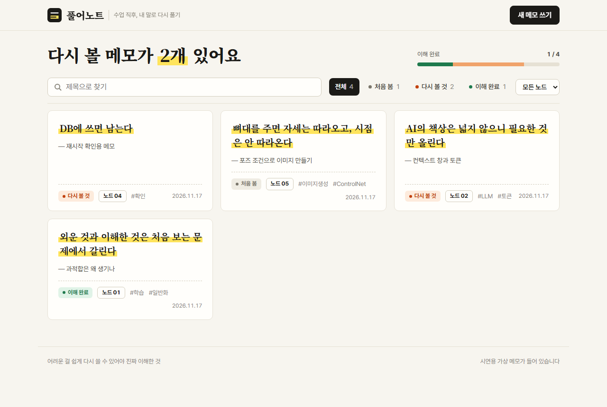
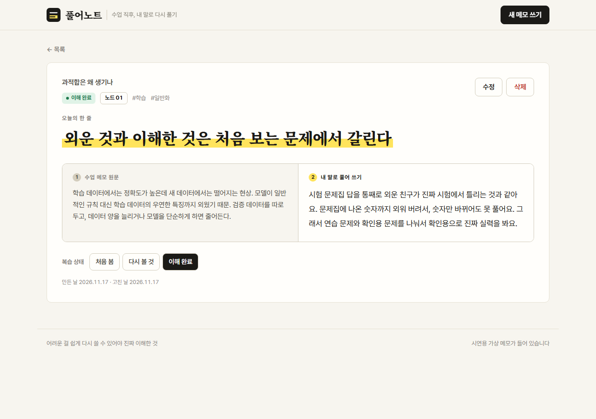
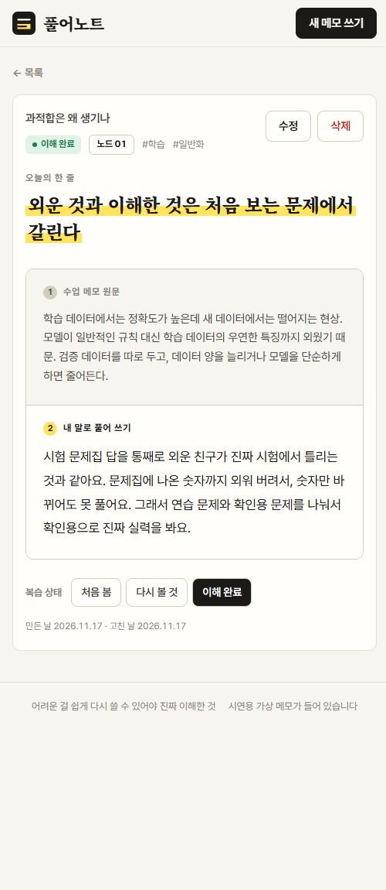

# 풀어노트

> 수업 직후, 내 말로 다시 풀기

받아 적은 수업 메모 옆에 **"초등학생도 알아듣게" 내 말로 다시 풀어 쓰는** 학습 노트 웹입니다.
어려운 내용을 쉽게 다시 쓰다가 막히는 곳이 아직 이해 못 한 곳이라는 생각에서 만들었습니다.

- **배포 주소:** https://puleo-note.onrender.com (첫 접속은 서버가 깨어나느라 30초쯤 걸릴 수 있습니다)
- **기획서:** [PRD.md](PRD.md)



## 무엇이 다른가

| 기능 | 화면에서 |
|---|---|
| 내 말로 풀어 쓰기 | 원문과 쉬운 버전이 좌우로 나란히 (폰에서는 위아래) |
| 오늘의 한 줄 | 목록 카드마다 핵심 한 문장을 크게 |
| 복습 상태 | 처음 봄 · 다시 볼 것 · 이해 완료 색 배지, 상세에서 바로 바꾸고 목록에서 거르기 |
| 노드·태그 | "노드 05", "#ControlNet"처럼 묶고, 태그를 누르면 그 태그만 |
| **AI 초등학생에게 읽혀 보기** | 내 말로 쓴 설명을 AI가 열 살 아이처럼 읽고, 알아들은 내용·궁금한 점·모르는 말을 돌려줌. API 키 없이 **브라우저 안에서** 도는 AI |



## AI 초등학생에게 읽혀 보기

"초등학생도 알아듣게" 썼는지 실제로 초등학생에게 읽혀 보는 기능입니다. 상세 화면 아래 버튼을 누르면 됩니다.

| 영역 | 무엇을 보여 주나 | 어떻게 |
|---|---|---|
| 바로 보이는 점 | 남아 있는 영어 낱말, 어려운 용어(토큰·추론·일반화 등), 80자 넘는 긴 문장, 원문보다 너무 짧은 설명 | AI 없이 규칙으로 바로 검사 |
| 알아들은 내용 | AI가 설명을 자기 말로 다시 말함. 내가 말하려던 것과 다르면 설명이 헷갈린다는 신호 | 브라우저 AI |
| 궁금한 점 | 읽고 나서 물어볼 질문 1~3개 | 브라우저 AI |
| 모르는 말 | 아이가 모를 낱말. 설명 본문에도 물결 밑줄로 표시 | 브라우저 AI + 검사 |

**동작 방식**

- **API 키·서버 비용 없음.** [WebLLM](https://github.com/mlc-ai/web-llm)으로 작은 언어 모델 **Qwen3 1.7B**를 방문자의 브라우저(WebGPU)에서 돌립니다.
- **메모는 밖으로 나가지 않습니다.** 서버로도 외부로도 보내지 않고 그 브라우저 안에서만 읽습니다. 모델 파일만 처음에 받습니다.
- **처음 한 번 약 1GB를 받습니다.** 받은 모델은 브라우저에 저장돼 다음부터는 불러오기만 합니다.
- 모델은 화면과 다른 일꾼(Web Worker, `public/llm-worker.js`)에서 돌아서 기다리는 동안 화면이 멈추지 않습니다.
- AI 답은 정해진 JSON 모양으로만 받습니다. "모르는 말"은 **설명에 실제로 있는 낱말만** 남기고, '종이'처럼 너무 쉬운 두 글자 낱말은 뺍니다(`public/kid-check.mjs`).
- **원문은 AI에게 주지 않습니다.** 아이는 '내 말로' 쓴 설명만 읽어야 하기 때문입니다.

**모델을 고른 이유:** 방문자가 키 없이 바로 써야 해서 브라우저에서 도는 모델 중 골랐습니다. 4B 이상은 받는 양이 2.5GB를 넘어 시연용으로 무겁고, 0.6B 이하는 가볍지만 한국어 문장력이 더 약한 크기라 중간인 Qwen3 1.7B(약 1GB, 여러 언어 학습)를 골랐습니다. 실제로 시험한 모델은 Qwen3 1.7B 하나입니다. 시연 메모에서 한국어로 다시 말하기와 질문 만들기가 됐고, 지시문을 "모르는 낱말은 '○○이 뭐야?'로 물어라"로 고친 뒤 어려운 용어를 짚는 비율이 나아졌습니다.

## 구조

```
브라우저 (public/: HTML·CSS·JS, 빌드 없음)
   │  └ AI 초등학생: kid-check.mjs(규칙·검사) + llm-worker.js(WebLLM, 브라우저 안에서만)
   │  fetch /api/notes …
   ▼
Express 서버 (server.js → src/app.js)
   │  입력 검사 (src/notes.js) → 매개변수 바인딩 SQL
   ▼
Supabase Postgres (notes 표, db/schema.sql)
```

| 방법 | 주소 | 하는 일 |
|---|---|---|
| GET | `/api/notes?q=&status=&node=&tag=` | 목록·제목 검색·거르기 |
| POST | `/api/notes` | 만들기 |
| GET | `/api/notes/:id` | 상세 |
| PUT | `/api/notes/:id` | 수정 |
| DELETE | `/api/notes/:id` | 삭제 |
| GET | `/api/health` | 서버·DB 연결 방식 확인 |

## 로컬에서 실행

Node.js 20.12 이상이 필요합니다.

```bash
npm install
npm start          # http://localhost:3200
npm test           # 자동 테스트 12개
```

- `.env`가 없으면 **메모리 DB**(pg-mem)로 뜹니다. 시연 메모 3건이 들어 있고, 서버를 끄면 사라집니다. 개발·테스트용입니다.
- `.env`에 `DATABASE_URL`을 넣으면 Supabase에 저장됩니다. `.env.example`을 참고하세요.
- 배포 환경(`NODE_ENV=production`)에서 `DATABASE_URL`이 없으면 서버가 시작하지 않습니다. 데이터가 사라지는 메모리 DB로 조용히 뜨는 것을 막기 위해서입니다.

## 배포 (Supabase + Render)

1. Supabase 새 프로젝트 → SQL Editor에서 `db/schema.sql` 실행 → (시연 메모가 필요하면) `db/seed.sql` 실행
2. Project Settings → Database → Connection string에서 **Session pooler** 주소를 복사 (Render는 IPv4만 쓰므로 Direct 주소 대신 pooler 주소)
3. Render → New → Blueprint → 이 저장소 연결 (`render.yaml`이 무료 웹 서비스·빌드·시작 명령을 채움)
4. `DATABASE_URL` 값 칸에 2번 주소
5. 배포가 끝나면 `https://<서비스이름>.onrender.com/api/health`가 `{"ok":true,"mode":"postgres"}`인지 확인

## 확인한 것

| 확인 | 결과 | 환경 |
|---|---|---|
| 자동 테스트 7개 (CRUD, 검색·거르기, 입력 오류, 길이 제한, 404·깨진 JSON, SQL 주입 문자열) | 통과 | 로컬, 메모리 DB |
| 브라우저에서 빈 칸 저장 → 칸별 오류 표시 | 확인 | 로컬 |
| 브라우저에서 직접 타이핑해 작성 → 저장 → 상세 → 상태 변경 → 수정 → 상태 거르기 → 삭제 | 확인 | 로컬 |
| 폰 화면(375px)에서 상세 화면 | 확인 | 로컬 |
| Supabase 첫 연결 시 표 자동 생성 + 시연 메모 3건 입력 | 확인 | 로컬 서버 → Supabase (도쿄 지역) |
| 메모 저장 → 서버 프로세스 종료 → 다시 시작 → 같은 메모를 그대로 읽음 (제목·상태·노드·태그·한 줄) | 확인 (2026-11-17) | 로컬 서버 → Supabase |
| `/api/health` → `{"ok":true,"mode":"postgres"}` | 확인 (2026-11-17) | Render → Supabase |
| 배포 주소에서 작성(201) → 읽기 → 수정(상태 done) → 상태·태그 거르기 → 빈 칸 저장 거부(400, 칸별 문구) → 삭제(204) → 삭제 후 읽기 404 | 확인 (2026-11-17) | Render → Supabase |
| 배포 주소를 폰 화면(375px)으로 열어 목록·상세, 가로 넘침 없음 | 확인 (2026-11-17) | Render |
| 자동 테스트 5개 추가: 규칙 검사(영어·용어·긴 문장·짧은 설명), 원문은 AI에게 안 넘김, 긴 설명 자르기, 설명에 없는·너무 쉬운 낱말 제거, 깨진 AI 답 오류 처리 | 통과 (모두 12개) | 로컬 |
| 브라우저 AI 실제 실행: 모델 첫 받기 약 2분 반(약 1GB), 메모 1건 읽기 38~45초, 결과 표시와 본문 물결 밑줄 | 확인 (2026-11-17, 시연 메모 2건) | 로컬, 인텔 내장 그래픽 |



## 한계

- 로그인이 없어 주소를 아는 누구나 메모를 쓰고 지울 수 있습니다. 시연용 가상 메모만 넣었습니다.
- Render 무료판은 15분쯤 쓰지 않으면 잠들어, 다음 첫 접속에 30초 정도 걸릴 수 있습니다.
- 검색은 제목만 찾습니다.
- 브라우저 AI는 PC의 크롬·엣지 최신판(WebGPU)에서만 됩니다. 폰은 대부분 안 되고, 안 되면 안내 문구가 나옵니다.
- 작은 모델이라 엉뚱한 질문을 하거나 설명을 거의 그대로 되풀이할 때가 있습니다. 화면에도 "참고만 하세요"라고 적었습니다. 규칙 검사는 AI와 상관없이 늘 같은 결과를 냅니다.

## 시연 메모

`db/seed.sql`의 메모 3건은 일반 AI 개념(과적합, 컨텍스트 창, 포즈 조건 이미지 생성)으로 새로 쓴 가상 메모입니다.
